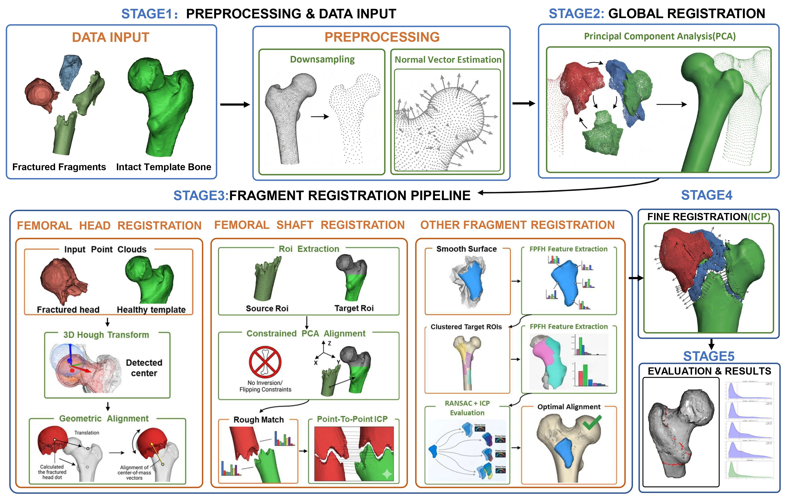

# HARMONIC

HARMONIC 是一个基于 **Python** 与 **Open3D** 的股骨近端粉碎性骨折点云配准与骨折线提取工程。项目以健侧骨模型作为模板，对患侧多个骨折碎片进行自动化复位配准，并将骨折边缘投影到镜像后的健侧模板上，生成三维骨折线可视化结果。

## 项目流程



整体流程包括：点云/网格读取、自适应体素下采样、健侧镜像、PCA 全局粗配准、碎片几何分类、股骨头/股骨干/游离碎片分策略配准、动态遮罩、误差评估，以及骨折线提取与可视化。

## 目录结构

```text
HARMONIC/
├── run_demo.py                  # 主运行入口
├── requirements.txt             # Python 依赖列表
├── README.md                    # 项目说明文档
├── process.jpg                  # 项目流程图
├── data/
│   ├── healthy_side/            # 健侧模板点云，例如 Example.ply
│   └── unhealthy_side/          # 患侧骨折碎片 STL/PLY 文件
├── results/                     # 程序输出结果
└── src/
    ├── config.py                # 全局参数配置
    ├── utils.py                 # 点云 I/O、预处理、评估与可视化工具
    ├── geometry_classifier.py   # 基于几何特征的碎片分类器
    ├── registration.py          # 核心配准流程与分策略算法
    ├── registration_wrappers.py # 碰撞检测、消融实验与扩展包装函数
    └── fracture_line.py         # 骨折线提取、投影与可视化
```

## 核心功能

- **自适应预处理**：根据健侧模板尺寸自动计算 voxel size，并对点云进行下采样、法向估计和离群点过滤。
- **健侧镜像模板**：将健侧点云沿指定坐标轴镜像，作为患侧复位参考。
- **PCA 全局粗配准**：合并患侧碎片后进行主成分分析，快速拉近源点云与目标模板。
- **几何碎片分类**：通过体积、线性度、球形度、表面积体积比等特征识别股骨头、股骨干和其他碎片。
- **分策略精配准**：股骨头使用霍夫球心检测，股骨干使用防翻转 ROI 约束，小碎片使用多 ROI RANSAC 与 ICP。
- **动态遮罩**：每配准一个碎片后从目标模板中剔除已占用区域，降低后续碎片空间争抢。
- **骨折线提取**：基于局部质心偏移检测断裂边缘，并将边缘点投影吸附到健侧模板表面。

## 环境安装

建议使用 Python 3.10 或 3.11。

```bash
pip install -r requirements.txt
```

当前主要依赖包括：

```text
numpy
open3d
matplotlib
scipy
scikit-learn
pandas
```

## 数据准备

默认数据路径由 `run_demo.py` 指定：

```text
data/
├── healthy_side/
│   └── Example.ply
└── unhealthy_side/
    ├── Anonymous_Smoothed_bone4_001.stl
    ├── Anonymous_Smoothed_head_001.stl
    └── Anonymous_Smoothed_shaft_001.stl
```

如果使用自己的数据，请修改 [run_demo.py](run_demo.py) 中的：

```python
SOURCE_FILES = [...]
TARGET_FILENAME = "Example.ply"
```

`SOURCE_FILES` 中只需要填写文件名，不要重复写 `data/unhealthy_side/` 路径。

## 运行方式

在项目根目录执行：

```bash
python run_demo.py
```

程序会自动创建 `results/` 文件夹，并将配准报告、点云结果、误差图和骨折线可视化文件保存到该目录。

## 输出结果

运行完成后，`results/` 中通常会包含：

- `adaptive_voxel_report.txt`：自适应 voxel size 与整体配准指标。
- `Density_Plot.png`：各碎片误差分布图。
- `Aligned_*.ply`：每个碎片配准后的点云。
- `Vis1_WithTemplate.ply`：含健侧模板的整体配准可视化结果。
- `Vis2_FragmentsOnly.ply`：仅包含复位碎片的可视化结果。
- `Vis3_Fracture_Lines.ply`：骨折线投影可视化结果。

## 参数配置

主要参数集中在 [src/config.py](src/config.py)：

- `ADAPTIVE_VOXEL_FACTOR`：控制自适应体素大小，值越大，采样越细。
- `HOUGH_CONFIG`：股骨头霍夫球心检测参数。
- `ROBUST_RANSAC_CONFIG`：多次 RANSAC 尝试次数和提前停止阈值。
- `SHAFT_FEATURE_ROI_RATIO` / `TARGET_SHAFT_ROI_RATIO`：股骨干 ROI 截取比例。
- `FRACTURE_LINE_CONFIG`：骨折线边界检测、投影、去噪和可视化参数。

## 常见问题

### 1. `No module named 'config'`

请从项目根目录运行：

```bash
python run_demo.py
```

`run_demo.py` 会把 `src/` 加入 Python 搜索路径。如果改用其他入口脚本，需要同步处理模块路径。

### 2. `No usable points after preprocessing`

通常是源文件路径写错、文件没有读到、或点云为空。请确认：

- `SOURCE_FILES` 只写文件名。
- 文件确实位于 `data/unhealthy_side/`。
- 健侧模板位于 `data/healthy_side/`。

### 3. 配准结果不理想

可以优先尝试调整：

- `ADAPTIVE_VOXEL_FACTOR`
- `CURVATURE_PERCENTILE`
- `ROBUST_RANSAC_CONFIG['max_attempts']`
- `FRACTURE_LINE_CONFIG` 中的边界检测和投影参数

## 说明

本项目用于医学图像处理与骨折复位算法研究。本例数据已进行去标签化处理